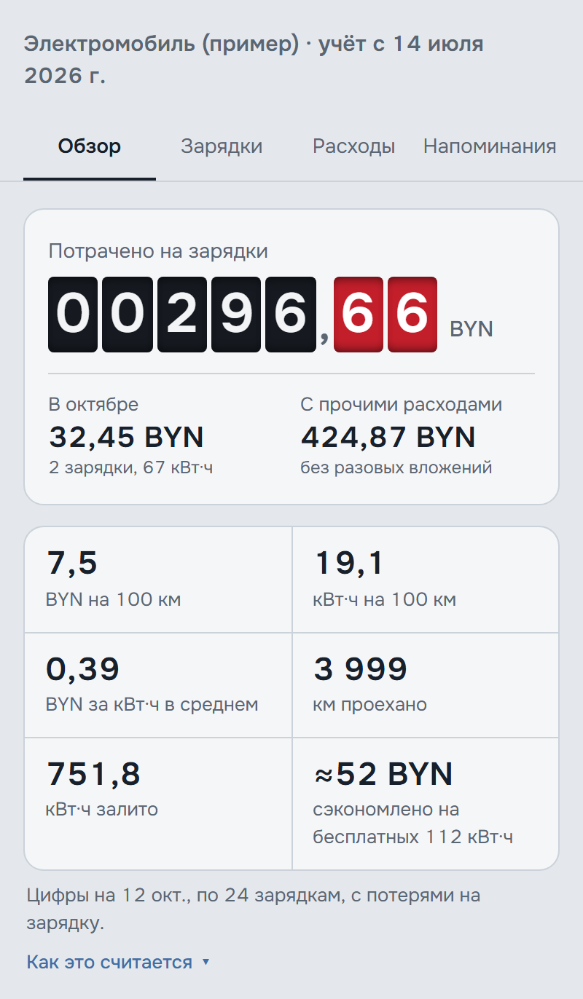
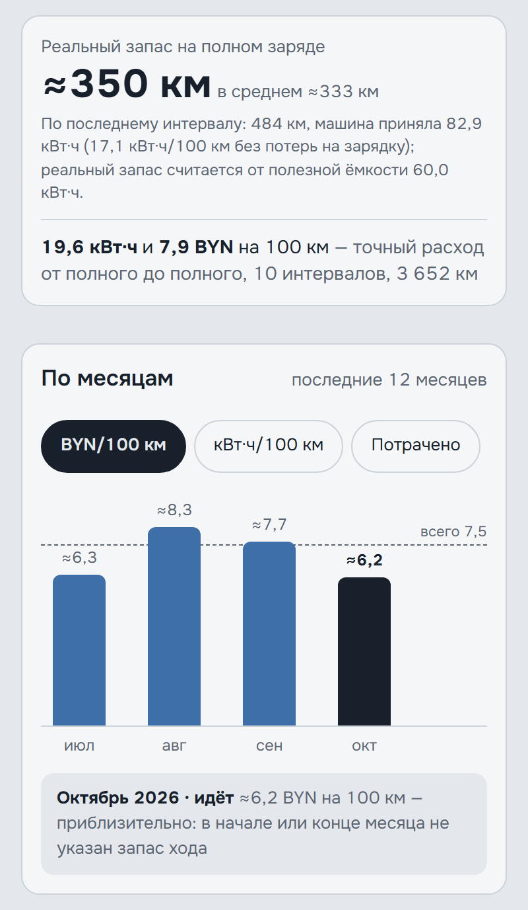
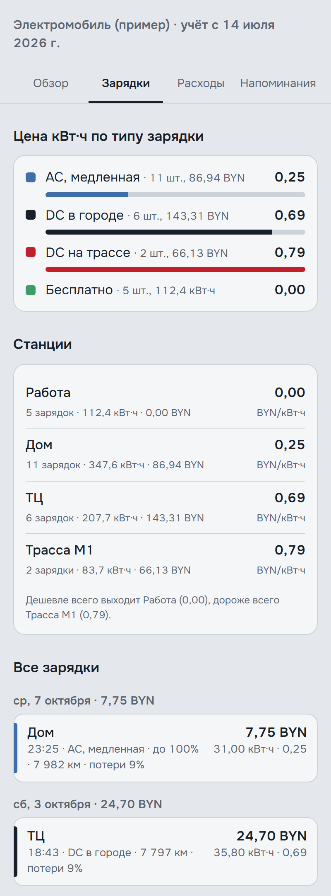

# Зарядки ⚡

Учёт зарядок и расходов на электромобиль — приложение для телефона, которое работает без интернета.

- зарядки: кВт·ч, сумма, станция, тип (AC, DC в городе, трасса), бесплатные;
- стоимость километра и расход кВт·ч/100 км с учётом заряда, оставшегося в батарее;
- точный расход и реальный запас хода по полным зарядкам;
- статистика по месяцам и станциям, доля дешёвых тарифов;
- прочие расходы: страховка по периодам, шины по пробегу, разовые вложения отдельно;
- напоминания по пробегу и датам (перестановка шин, ТО, страховка);
- режим для гибридов с розеткой (например, EX5 EM-i, EM-R): зарядки и заправки, цена километра от полного бака до полного, доля денег на электричество.

<p>
  
  
  
</p>

<sub>На скриншотах — вымышленные данные из «Посмотреть пример».</sub>

**Ваши данные хранятся только на вашем телефоне** и никуда не отправляются ([подробнее](app/privacy.html)). У каждого профиля браузера (в Edge, Chrome) свои отдельные данные — пользуйтесь приложением из одного профиля, иначе записи разойдутся по профилям. Для переноса на другой телефон — «Настройки» → «Данные» → «Сохранить резервную копию», на новом телефоне — «Загрузить копию» (или «Загрузить файл» в настройках).

## Как установить

Откройте адрес приложения на телефоне:
- **Android (Chrome):** ⋮ → «Установить приложение» / «Добавить на главный экран».
- **iPhone (Safari):** «Поделиться» → «На экран „Домой“». Пользуйтесь приложением именно с иконки: у Safari и у иконки разные хранилища.

## Для разработки

```
npm install
npm start      # http://localhost:8765
npm test       # автотесты
```

Как устроен проект и как выпускать версии — в [CLAUDE.md](CLAUDE.md). План — в [docs/ROADMAP.md](docs/ROADMAP.md).
